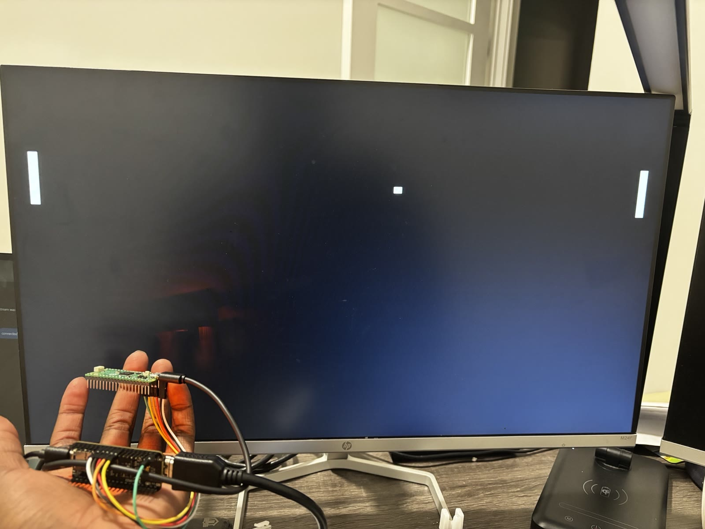
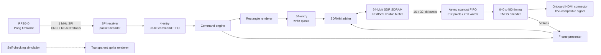
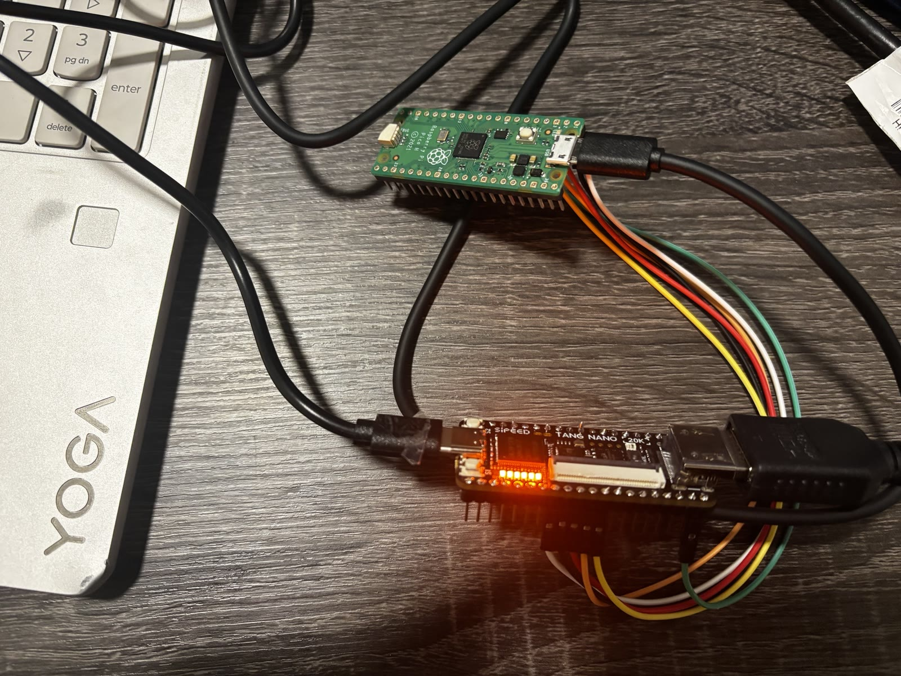
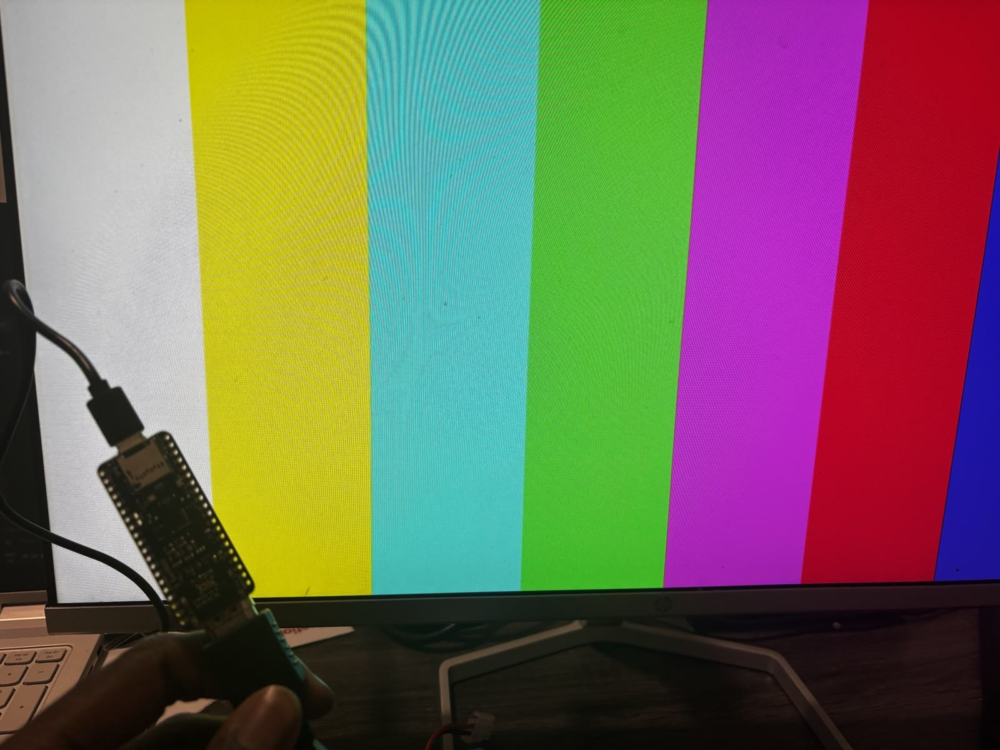

# FPGA 2D Graphics Accelerator

A hardware-validated 2D graphics pipeline for the Sipeed Tang Nano 20K. An RP2040 sends drawing commands over SPI, the FPGA renders into an SDRAM-backed RGB565 framebuffer, and the result is scanned out as 640 x 480 DVI-compatible video through the board's HDMI connector.

[](media/pong-demo.mp4)

**[Watch the 16-second hardware demo](media/pong-demo.mp4)**

## Highlights

- Autonomous two-AI Pong demo running on physical Tang Nano 20K and RP2040 hardware.
- 640 x 480 RGB565 double framebuffer in the FPGA package's 64-Mbit SDR SDRAM.
- DVI-compatible TMDS output at a 25.2 MHz pixel clock and 126 MHz serializer clock.
- CRC-protected SPI mode 0 command link with READY backpressure and status reporting.
- Clipped rectangle renderer integrated into the hardware command path.
- Transparent sprite renderer implemented and covered by self-checking simulation.
- Burst-based SDRAM scanout with write/read queues, arbitration, and asynchronous clock-domain crossing.
- 20 self-checking SystemVerilog testbenches plus 2 host-side C tests.
- Final FPGA implementation closes timing at the 161.996 MHz controller constraint.

## Architecture



The 162 MHz controller/memory domain and 25.2 MHz pixel domain are separated with a Gray-pointer asynchronous FIFO and synchronized control crossings. Scanout traffic is protected by low-water refill arbitration while renderer writes are queued and committed before a VBlank-safe buffer swap.

> [!NOTE]
> The final Pong bitstream dispatches `CLEAR`, `DRAW_RECT`, and `PRESENT`. The sprite renderer and `DRAW_SPRITE` packet encoder are implemented and tested, but sprite dispatch is not connected to the final hardware command engine.

## Hardware

| Component | Implementation |
| --- | --- |
| FPGA board | Sipeed Tang Nano 20K, GW2AR-LV18QN88C8/I7 |
| Host | Raspberry Pi Pico-class RP2040 board, Pico SDK `pico` target |
| Framebuffer memory | 64-Mbit, 32-bit SDR SDRAM embedded in the GW2AR-18 package |
| Display interface | Onboard HDMI connector carrying DVI-compatible TMDS |
| Host link | SPI mode 0, MSB first, 1 MHz, plus a READY GPIO |
| Programming/debug | Tang Nano onboard BL616/Gowin USB Cable JTAG at 2.5 MHz; USB serial and onboard LEDs |

### RP2040-to-FPGA wiring

| RP2040 | Direction at RP2040 | Signal | Tang Nano 20K | FPGA pin |
| --- | --- | --- | --- | --- |
| GP0 | Input | MISO | J6-8 | 27 |
| GP1 | Output | CS_N | J6-9 | 28 |
| GP2 | Output | SCLK | J6-10 | 25 |
| GP3 | Output | MOSI | J6-11 | 26 |
| GP4 | Input | READY | J6-12 | 29 |
| GND | - | Common ground | J6-20 | GND |

Both boards may remain powered from their own USB connectors. Connect the five 3.3 V logic signals and common ground only; do **not** join 5 V, VSYS, or 3V3 rails between the powered boards.



## Quick start

The scripts target Windows PowerShell. The tested toolchain is:

- Verilator 5.050 through MSYS2 UCRT64 at `C:\msys64`.
- Gowin EDA Education 1.9.11.03. Set `GOWIN_ROOT` if it is not installed at `C:\Gowin\Gowin_V1.9.11.03_Education_x64`.
- Raspberry Pi Pico SDK 2.3.1. Set `PICO_SDK_PATH` if it is not installed at `C:\pico-sdk`.
- CMake 4.4.4, MinGW Makefiles, and ARM GCC 13.3 for RP2040 firmware.

Run every RTL and host-side regression:

```powershell
pwsh -File scripts/test.ps1
```

Build and program the final FPGA image into volatile SRAM:

```powershell
pwsh -File scripts/build_sdram_scanout.ps1
pwsh -File scripts/program_sdram_scanout_sram.ps1
```

Build the autonomous Pong firmware:

```powershell
pwsh -File scripts/build_pico_pong.ps1
```

Hold BOOTSEL while connecting the RP2040, then flash the detected `RPI-RP2` volume:

```powershell
pwsh -File scripts/flash_pico_pong.ps1
```

The FPGA programming script uses SRAM operation 2 only. Removing power restores the previous FPGA configuration.

## Measured implementation results

These are tool-reported or directly observed results from the final command-link build. Values that were not measured are not estimated.

| Metric | Result |
| --- | --- |
| Output resolution | 640 x 480 RGB565 |
| Video timing | 800 x 525 at 25.2 MHz; nominal approximately 60 Hz |
| Controller constraint | 161.996 MHz |
| Reported controller Fmax | 163.612 MHz |
| Hardware-stable SDRAM/controller clock | 162 MHz |
| Pixel clock constraint | 25.200 MHz |
| Reported pixel-domain Fmax | 72.109 MHz |
| Serializer clock | 126 MHz |
| Worst setup slack | +0.061 ns |
| Setup / hold TNS | 0.000 ns / 0.000 ns |
| Failing timing endpoints | 0 |
| Logic elements | 3,138 / 20,736 (16%) |
| LUTs / ALUs | 1,794 / 426 |
| Registers | 1,465 / 15,915 (10%) |
| RAM16 / SSRAM elements | 153 |
| BSRAM | 4 / 46 blocks (9%) |
| Hardware-validated SPI clock | 1 MHz |
| SDRAM read burst | 16 x 32-bit words = 32 RGB565 pixels |

The nominal refresh rate comes from the configured timing generator; it was not externally measured. Memory bandwidth, render latency, primitive throughput, and Pong frame rate were not instrumented, so this project makes no measured claim for them.

## Memory and rendering pipeline

- Two 614,400-byte framebuffers fit in the 8 MiB SDRAM address space.
- The scanout prefetcher requests 16 consecutive 32-bit words per SDRAM command.
- A 512-pixel / 256-word asynchronous FIFO crosses into the pixel domain.
- A 64-entry write queue decouples rectangle generation from SDRAM commits.
- The arbiter prioritizes scanout refill while guaranteeing renderer progress.
- The presenter waits for committed writes, flushes stale scanout data, and swaps only at VBlank.
- The full-memory BIST checks all 2,097,152 32-bit words with two data patterns.
- A 16-phase hardware sweep selected SDRAM clock phase 11 (247.5 degrees).

The first per-pixel and packed-word scanout designs showed moving RGB corruption on hardware. The final burst-read path removed the underflow and produced stable color bars before the command link and Pong demo were enabled.



## Verification

`scripts/test.ps1` builds and runs 20 SystemVerilog testbenches with Verilator and 2 C tests with GCC. The tests automatically compare expected and actual timing, packets, pixels, addresses, handshakes, FIFO order, frame swaps, and error counters.

Coverage includes:

- 640 x 480 timing, DVI control tokens, TMDS symbols, and color bars.
- Synchronous/asynchronous FIFOs and cross-domain backpressure.
- SPI mode 0, CRC errors, truncated packets, READY flow control, and status.
- Rectangle clipping, transparent sprite rendering, and command ordering.
- SDRAM BIST, address mapping, queued writes, burst reads, and arbitration.
- Scanout underflow behavior and VBlank-safe double buffering.
- Integrated `CLEAR` / `DRAW_RECT` / `PRESENT` execution.
- Pong physics, paddle AI, packet encoding, and status compatibility.

Physical validation used the display, USB serial counters, and six onboard diagnostic LEDs. No oscilloscope or logic analyzer was used. The final demo advanced from frame 300 / packet 1500 to frame 360 / packet 1800 with status `0x13` and zero READY timeouts.

## Repository layout

```text
constraints/       Tang Nano 20K pin and timing constraints
docs/              Protocol, bring-up record, and architecture decision
firmware/rp2040/   Pico SDK link driver, protocol encoder, and Pong demo
fpga/              Gowin project-generation Tcl scripts
media/             Metadata-stripped hardware photos and demo video
rtl/common/        Shared command types and FIFOs
rtl/graphics/      Command engine and rectangle/sprite renderers
rtl/interface/     SPI receiver and packet decoder
rtl/memory/        SDRAM adapter, queues, prefetch, BIST, and arbiter
rtl/top/           Tang Nano 20K integration and clock wrappers
rtl/video/         Timing, framebuffer scanout, presentation, and TMDS
scripts/           Repeatable test, build, program, and flash commands
sim/               Self-checking SystemVerilog testbenches and file lists
vendor/gowin/      Documented Gowin SDRAM controller boundary
```

## Documentation

- [Build specification](SPEC.md)
- [Hardware bring-up and measured evidence](docs/bringup.md)
- [RP2040-to-FPGA command protocol](docs/protocol.md)
- [ADR: use the Gowin embedded SDRAM controller](docs/decisions/0001-use-gowin-embedded-sdram-controller.md)

## Project status

The final Tang Nano 20K image, SDRAM framebuffer and scanout, RP2040 SPI command link, rectangle rendering, VBlank-safe presentation, and autonomous Pong demo are verified in simulation and on physical hardware. Sprite rendering is self-checking in simulation but remains outside the final hardware dispatch path.

## License

Released under the [MIT License](LICENSE).
