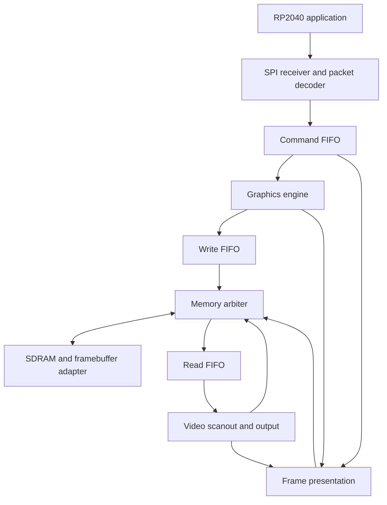

# Build Specification: FPGA 2D Graphics Accelerator and Memory System

Status: Approved; implementation in progress  
Owner: Joel Obinna-Eze  
Last updated: 2026-10-06

## Objective

Build a small 2D graphics accelerator in synthesizable SystemVerilog for a Tang Nano 20K FPGA. An RP2040 runs the application or game and sends drawing commands over SPI. The FPGA receives commands, renders pixels, manages a framebuffer, and continuously produces video output.

The final system shall provide:

- A 640 x 480 RGB565 framebuffer in SDRAM.
- Clipped rectangle and transparent-sprite rendering.
- An SPI command interface with explicit flow control.
- Burst-based memory access with buffered scanout and rendering.
- Front/back framebuffers swapped only at a safe vertical-blanking boundary.
- A Pong or Breakout demonstration plus reproducible measurements.

The graphics engine and memory system are the project. The game is only the final demonstration.

## Current State and Assumptions

- All ordered parts arrived by 2026-10-06. The FPGA board enumerates and its
  JTAG ID identifies a GW2AR-18C device.
- Portable video, framebuffer, rendering, command-link, frame-presentation,
  and Pong logic have self-checking tests. Board-specific LED and 640 x 480 DVI
  color-bar targets pass simulation, synthesis, place-and-route, timing, SRAM
  programming, and physical hardware observation.
- The FPGA target is the Tang Nano 20K's documented GW2AR-LV18QN88C8/I7.
- The host firmware target is a generic RP2040 board using the Pico SDK.
- The framebuffer format is RGB565 and the final logical resolution is 640 x 480.
- Hardware-specific facts must come from the exact board schematic, device data sheet, and SDRAM documentation.
- No milestone is complete until its acceptance criterion is met and recorded.

## Scope

Required:

- SystemVerilog graphics RTL.
- Rectangle fill with clipping.
- Sprite drawing with explicit transparency.
- SPI packet reception, validation, command queuing, and status/flow control.
- SDRAM-backed RGB565 framebuffer.
- Read and write FIFOs plus bounded burst transfers.
- Memory arbitration that protects scanout while allowing rendering progress.
- 640 x 480 video output through the confirmed board interface.
- Front/back buffer ownership and VBlank presentation.
- Self-checking simulation and separately recorded hardware evidence.

Out of scope:

- 3D rendering, shaders, texture filtering, or a general-purpose GPU ISA.
- A soft CPU, operating system, or ASIC implementation.
- Features added only for hypothetical future use.

## Capability Map

| Module id | Responsibility | Depends on |
| --- | --- | --- |
| `platform-bringup` | Confirm hardware, tools, clocks, reset, constraints, and programming | - |
| `video-scanout` | Generate timing, patterns, scanout, and the physical video output | `platform-bringup` |
| `framebuffer-memory` | Provide logical framebuffer access, BSRAM prototype, SDRAM control, FIFOs, and arbitration | `platform-bringup`, `video-scanout` |
| `graphics-rendering` | Execute clear, rectangle, and sprite operations against the logical framebuffer interface | `framebuffer-memory` |
| `host-command-link` | Receive SPI packets, queue complete commands, expose status, and run RP2040 command firmware | `graphics-rendering` |
| `frame-presentation` | Track buffer ownership, committed writes, prefetch state, VBlank swaps, and completion | `video-scanout`, `framebuffer-memory`, `graphics-rendering`, `host-command-link` |
| `demo-measurements` | Run the game demo and record timing, utilization, bandwidth, throughput, and errors | all prior modules |

Build order: `platform-bringup` -> `video-scanout` -> `framebuffer-memory` -> `graphics-rendering` -> `host-command-link` -> `frame-presentation` -> `demo-measurements`.

## Architecture



Rendering logic shall use a logical framebuffer interface and shall not issue physical SDRAM commands directly. That interface must work first with a simulation memory model, then a small on-chip framebuffer, and finally an SDRAM adapter.

Proposed modules:

| Module | Responsibility |
| --- | --- |
| `video_timing` | Pixel/line counters, active video, sync, and VBlank events |
| `video_out` | Conversion from pixels/timing to the confirmed physical video interface |
| `spi_rx` | Safe byte reception from the external SPI interface |
| `command_decoder` | Packet framing, validation, and command emission |
| `command_fifo` | Storage of complete accepted commands |
| `graphics_engine` | In-order command execution and renderer dispatch |
| `rect_renderer` | Clipped rectangle write generation |
| `sprite_renderer` | Sprite ROM lookup, transparency, clipping, and write generation |
| `framebuffer_bram` | Small portable framebuffer used before SDRAM integration |
| `write_fifo`, `read_fifo` | Decoupling of render, memory, and scanout rates |
| `memory_arbiter` | Scheduling of scanout reads, renderer writes, and refresh |
| `sdram_adapter` | Project request/burst adaptation around Gowin's embedded SDRAM controller |
| `frame_swap` | Buffer ownership and safe presentation |
| `top` | Board clock, reset, pins, and backend integration |

## Hardware and Toolchain

Selected stack:

- FPGA board: Tang Nano 20K, GW2AR-LV18QN88C8/I7.
- Memory: 64-Mbit, 32-bit SDR SDRAM embedded in the GW2AR-18 system-in-package;
  2,097,152 words are exposed through a 21-bit word address.
- Input clock: onboard 27 MHz crystal; generated clocks remain board-verified values.
- Video: onboard HDMI connector carrying DVI-compatible 640 x 480p60 output.
- Host board: generic RP2040 board, SPI mode 0, MSB first, initially 8 MHz.
- FPGA implementation: Gowin EDA Education 1.9.11.03 on Windows 11.
- RTL: synthesizable SystemVerilog.
- Simulation/lint: Verilator 5.050 installed through MSYS2 UCRT64.
- Firmware: C/C++ with Raspberry Pi Pico SDK 2.3.1 and CMake.
- Debug: USB logic analyzer and board-visible test patterns where available.

Before board-specific RTL or constraints, record in `docs/bringup.md`:

- Exact boards, FPGA device, embedded SDRAM organization, and data sheets.
- Board oscillator, legal PLL configuration, clock targets, and reset sources.
- Video connector, electrical signaling, encoding, and pin mapping.
- FPGA I/O voltages and RP2040-to-FPGA wiring.
- Development OS, installed tool versions, programmer, and programming procedure.

RGB565 defines pixel storage, not the connector protocol. HDMI-compatible/DVI-style output requires a separate, board-specific encoding and serialization block.

## Commands

Commands are added only after they run successfully. Current commands:

Required command categories:

| Purpose | Command |
| --- | --- |
| RTL simulation | `pwsh -File scripts/test.ps1` |
| All self-checking tests | `pwsh -File scripts/test.ps1` |
| FPGA LED synthesis/place-and-route | `pwsh -File scripts/build_led.ps1` |
| FPGA LED volatile SRAM programming | `pwsh -File scripts/program_led_sram.ps1` |
| FPGA DVI synthesis/place-and-route | `pwsh -File scripts/build_dvi.ps1` |
| FPGA DVI volatile SRAM programming | `pwsh -File scripts/program_dvi_sram.ps1` |
| FPGA SDRAM BIST synthesis/place-and-route | `pwsh -File scripts/build_sdram_bist.ps1` |
| FPGA SDRAM BIST volatile SRAM programming | `pwsh -File scripts/program_sdram_bist_sram.ps1` |
| Timing and utilization reports | `build/gowin/<target>/impl/pnr/` |
| RP2040 firmware configure/build/flash | TBD in Stage 0 |

## Repository Structure

```text
rtl/common/        FIFOs, reset helpers, and shared types
rtl/video/         Timing, scanout, and board-specific video output
rtl/graphics/      Command execution and rectangle/sprite renderers
rtl/interface/     SPI reception, decoding, status, and flow control
rtl/memory/        BSRAM backend, SDRAM adapter/controller, and arbitration
rtl/top/           Board integration
sim/               Self-checking testbenches, scoreboards, and memory models
firmware/rp2040/   Packet encoder, SPI driver, input, and game demo
constraints/       Verified board pin and timing constraints
scripts/           Reproducible build and test entry points
docs/              Protocol, clocks, bring-up, architecture, and measurements
assets/            Sprite sources and reproducible ROM-generation inputs
```

Generated tool caches, bitstream intermediates, and large waveform files shall not be committed.

## RTL Style and Interface Rules

- Use nonblocking assignments in sequential logic.
- Give every combinational output a complete assignment.
- Avoid inferred latches, fabric-generated clocks, and undocumented vendor behavior.
- Keep one internal clock domain until a separate domain is required.
- Synchronize reset release independently in every clock domain.
- Isolate vendor primitives behind small wrappers with portable simulation models.
- Parameterize image dimensions and queue depths only where tests need alternate sizes.
- Name addresses with units, such as `pixel_index`, `byte_address`, or `word_address`.
- Define clock, reset, ordering, units, and stall behavior in every module header.

Example sequential style:

```systemverilog
always_ff @(posedge clk) begin
    if (rst) begin
        command_valid <= 1'b0;
    end else if (command_ready) begin
        command_valid <= decoded_valid;
    end
end
```

For a `valid`/`ready` interface, a transfer occurs only on a clock edge where both are high. A stalled producer must keep its payload and `valid` stable.

## Pixel and Address Contract

RGB565 layout:

- Red: bits `[15:11]`.
- Green: bits `[10:5]`.
- Blue: bits `[4:0]`.

```text
pixel_index  = y * FRAME_WIDTH + x
byte_address = buffer_base_bytes + 2 * pixel_index
```

At 640 x 480:

- One framebuffer is 614,400 bytes (600 KiB).
- Two framebuffers are 1,228,800 bytes (1,200 KiB).
- Scanout payload bandwidth is `614,400 * refresh_rate_hz` bytes/s.
- At an illustrative 60 Hz, payload reads alone are 36.864 MB/s.

The 60 Hz value is an estimate, not a selected or measured mode. Arbitration must also budget for refresh, row operations, turnarounds, rendering, and worst-case service latency.

The temporary BSRAM framebuffer shall be smaller and parameterized to fit confirmed on-chip memory. Logical framebuffer dimensions and output timing dimensions must remain separate.

## Rendering Contract

### Rectangles

`DRAW_RECT(x, y, width, height, color)` fills the half-open region `[x, x + width) x [y, y + height)` after clipping to the logical framebuffer.

- Zero width or height completes without writes.
- A fully off-screen rectangle completes without writes.
- Clipping occurs before address calculation.
- Coordinate sums use widened arithmetic and cannot wrap into valid addresses.
- Initial coordinates are unsigned; signed positions require a protocol revision.
- Every accepted write must remain inside the selected draw buffer.

`DRAW_RECT(10, 20, 4, 3, RED)` must modify exactly 12 pixels: x=10..13 and y=20..22.

### Sprites

`DRAW_SPRITE(sprite_id, x, y)` reads a descriptor and sprite ROM, then emits writes for opaque pixels.

- Transparency uses a separate opaque bit or mask, not a reserved RGB565 color.
- Clipping preserves the matching source coordinates.
- Invalid sprite IDs fail deterministically and perform no out-of-range read.
- Output stalls must not duplicate, skip, or reorder opaque pixels.

### Commands

The initial command set is `CLEAR(color)`, `DRAW_RECT(...)`, `DRAW_SPRITE(...)`, and `PRESENT`. `CLEAR` may reuse rectangle rendering over the full draw buffer.

Commands execute in order. Received, queued, renderer-complete, memory-committed, and presentation-complete are distinct states. A frame swap waits for committed writes, not merely renderer completion.

## SPI and Clock-Domain Contract

Before SPI RTL and firmware, `docs/protocol.md` must freeze:

- SPI mode, bit order, SCLK limits, and chip-select behavior.
- Packet framing, opcodes, field widths, byte order, and payload lengths.
- Handling of partial packets, invalid opcodes, malformed fields, and reset.
- FIFO capacity and a host-visible ready/capacity mechanism.
- Definitions of queued, busy, committed, completed, and error status.
- Presentation completion reporting.

The FPGA must reserve capacity for an entire accepted packet and must never silently drop a command. SPI backpressure cannot rely on pausing the sender mid-packet.

External SPI inputs require a deliberate sampling or clock-domain-crossing design. If oversampling is used, its clock-ratio bound must be documented and tested. If SCLK is its own domain, use a coherent multi-bit crossing such as an asynchronous FIFO. Independent two-flop synchronizers on packet bits are invalid.

Every later video or memory crossing must be documented and implemented with a suitable synchronizer, asynchronous FIFO, or handshake.

## SDRAM and Arbitration Contract

Use Gowin's official embedded SDRAM controller for initialization, refresh,
physical commands, and the fixed package-internal interface. Preserve its
license and exact SDRAM-side top-level port names. Project-owned RTL shall wrap
the controller's 21-bit word-addressed, 32-bit user interface and isolate it
from the logical framebuffer interface. See ADR-001.

Controller integration must be verified in simulation and hardware, including
clock phase, request/acknowledge behavior, read-valid timing, full address
coverage, and complementary data patterns.

The logical framebuffer uses 22-bit RGB565 pixel addresses. Two adjacent
pixels share each 32-bit SDRAM word: an even pixel occupies bits 15:0 and an
odd pixel occupies bits 31:16. Partial writes use the controller byte mask so
updating either pixel preserves its neighbor.

The arbiter shall:

- Prioritize scanout when read-FIFO occupancy falls below a derived threshold.
- Derive the threshold from pixel consumption, worst-case memory latency, and margin.
- Bound non-preemptible write bursts.
- Schedule mandatory refresh.
- Guarantee renderer progress within a documented supported load.
- Count scanout underflow, write overflow, protocol errors, and minimum read-FIFO occupancy.

Video-to-memory FIFOs cross between independently generated 25.2 MHz pixel and
162 MHz controller clocks. They shall use Gray-coded pointers with two-stage
synchronizers; multi-bit payloads shall remain in dual-port storage rather than
passing through independent bit synchronizers. Both FIFO domains must be reset
together before traffic begins.

On scanout underflow, output a documented fallback pixel and latch an error. Never replay stale FIFO data as valid video.

## Frame-Presentation Contract

1. Scanout owns the front buffer; drawing owns the back buffer.
2. `PRESENT` creates a pending presentation and prevents later drawing from reusing that buffer.
3. Presentation waits until all prior commands and outstanding writes are committed.
4. The swap occurs only at a safe VBlank boundary; if not ready, it waits for the next frame.
5. Old-front prefetch data and outstanding reads are drained or invalidated.
6. Prefetch restarts at the new front buffer before presentation is acknowledged.
7. The old front buffer then becomes the draw buffer.

Startup framebuffer contents must be deterministic. A swap does not implicitly clear the new back buffer.

## Testing Strategy

Tests shall be self-checking, deterministic, and fail on mismatch or timeout. Waveforms are diagnostic output, not pass/fail evidence. A software reference framebuffer shall perform pixel-by-pixel comparisons.

Minimum checks:

| Area | Required cases |
| --- | --- |
| Video timing | Active coordinates, totals, sync polarity, blanking, reset alignment |
| Addressing | First/last pixel, line boundary, buffer boundary, widened arithmetic |
| Rectangles | Single pixel, ordinary, zero size, full screen, clipped edges, fully off-screen, maximum fields |
| Sprites | Source indexing, mask transparency, clipping, invalid ID, stalled writes |
| FIFOs | Empty/full, simultaneous push/pop, wraparound, stalls, reset, ordering; varied clocks for async FIFOs |
| SPI | Valid, truncated, interrupted, invalid opcode, full queue, back-to-back packets |
| SDRAM | Initialization, refresh, readback patterns, burst boundaries, address map, delayed responses, physical timing |
| Arbitration | Random stalls, near-empty read FIFO, heavy writes, refresh pressure, bounded rendering progress |
| Presentation | Delayed writes, missed VBlank, consecutive requests, stale prefetch, reset while pending |

Randomized tests must use reproducible seeds and print the failing seed.

Simulation success, synthesis/timing success, and hardware success are separate results and must be reported separately.

## Milestones and Acceptance Criteria

| Stage | Work | Acceptance criterion |
| --- | --- | --- |
| 0 | Confirm inventory/toolchain; repository skeleton; LED bring-up | Device and constraints documented; exact commands recorded; first bitstream programs and behaves as expected |
| 1 | Video timing and generated patterns | Testbench checks line/frame counts and blanking; display locks and shows stable patterns |
| 2 | Small BSRAM framebuffer and scanout | Known pixel map displays correctly; addressing and read latency pass tests |
| 3 | Rectangle renderer and clipping | Reference model matches every changed pixel, including edge and zero-size cases |
| 4 | SPI decoder, command FIFO, RP2040 sender | Packet/error/flow-control tests pass; RP2040 produces visible rectangle commands |
| 5 | Sprite ROM, transparency, and clipping | Pixel comparisons pass for opaque, transparent, and clipped sprites |
| 6 | SDRAM controller/adapter and standalone memory tests | Timing/refresh simulation passes; hardware readback succeeds with several patterns |
| 7 | FIFOs, burst scheduling, and arbiter | Supported concurrent load runs without underflow or lost writes |
| 8 | Full 640 x 480 RGB565 scanout | Full-size SDRAM framebuffer displays correctly |
| 9 | Front/back buffers and presentation | Tests prove committed writes, safe swaps, prefetch ownership, and no early reuse |
| 10 | Game demo and measurements | Demo runs; reproducible procedure and measured results are documented |

Temporary patterns and small framebuffers are debug stages, not substitutes for the final SDRAM design.

## Boundaries

Always:

- Preserve user changes and keep each milestone independently verifiable.
- Use official documentation for pins, voltages, clocks, and memory timing.
- Pair non-trivial RTL with the smallest self-checking test that can fail when it breaks.
- Handle reset, stalls, backpressure, overflow, invalid input, and legal address bounds explicitly.
- Run and report exact relevant commands before claiming a milestone passes.

Ask first:

- Changing the final resolution, pixel format, command set, or module boundaries.
- Adding a dependency, third-party RTL core, or vendor IP block.
- Choosing signed coordinates or changing packet compatibility.
- Changing board wiring, pin constraints, clock targets, or memory mapping.

Never:

- Invent pin assignments, voltages, SDRAM timings, or tool results.
- Claim hardware success from simulation or synthesis alone.
- Hide timing or CDC failures with unjustified false paths.
- Drop commands or pixels silently.
- Commit secrets, generated caches, large waveforms, or unlicensed third-party code.

## Project Completion

The project is complete only when:

- Every required feature is present and its self-checking tests pass.
- Full-resolution scanout uses the verified SDRAM implementation.
- Presentation tests and hardware observation show no tearing or stale-buffer data.
- The RP2040 reliably controls the accelerator under the documented flow-control rules.
- Pong or Breakout runs as a demonstration.
- Reproducible documentation records device and tool versions, clocks, constraints, test procedures, and report sources.
- Measured timing, utilization, memory bandwidth, scanout share, renderer throughput/latency, command throughput, FIFO occupancy, and underflow/overflow counts are recorded.
- Calculated estimates, tool reports, and hardware measurements are clearly distinguished.

## Deferred Hardware Verification

- Confirm the board/schematic revision and remaining external I/O voltages
  before enabling the RP2040 constraints.
- Confirm generated pixel, serializer, and memory clocks in Gowin timing reports.
- Start with a 512-pixel scanout FIFO, a 256-pixel low-water mark, and write
  bursts capped at 32 pixels; retain these as tunable parameters until measured.
- Keep the official embedded SDRAM controller behind a project-owned adapter,
  as recorded in ADR-001.
- Store sprites as RGB565 words plus a separate one-bit opacity mask.
- Use Pong as the final demonstration.
